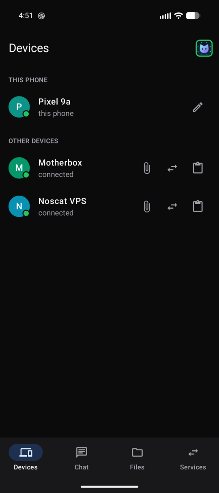
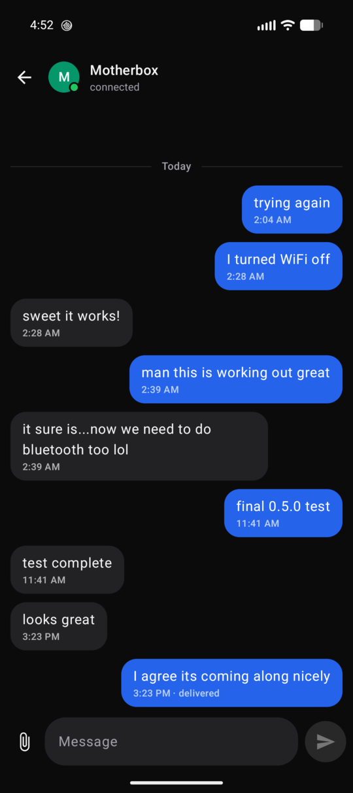
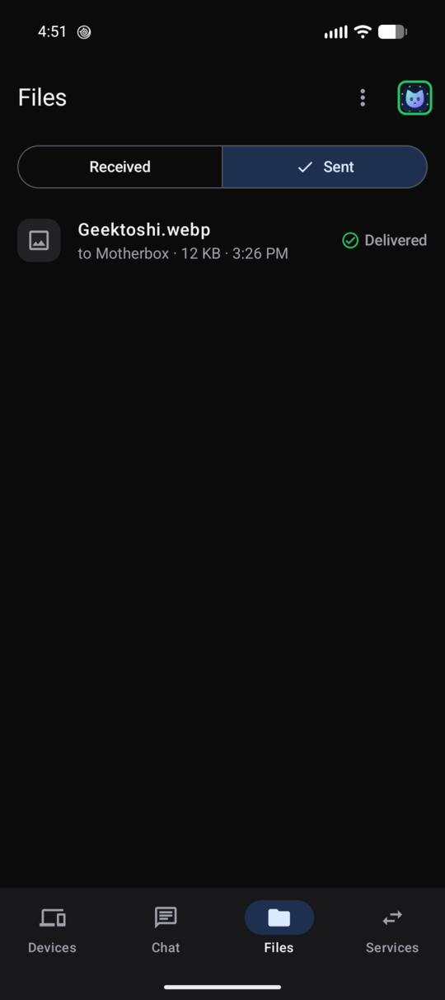

# Noscat for Android

Android client for [Noscat](https://github.com/Letdown2491/noscat), a private
device mesh on Nostr: membership is a Marmot (MLS) group on Nostr relays, and data
goes device to device over FIPS. Native Kotlin (Compose) over a Rust UniFFI bridge;
the protocol lives in the Noscat workspace (`noscat-core`/`noscat-client`/
`noscat-ffi`), so this repo contains no protocol code.

Status: chat, file send/receive, port forwards to a member's services,
clipboard sharing, joining a mesh by scanning a member's QR, and (new in
0.6) terminals on the mesh's computers and a choice of who may send things
to the phone. Version 0.7.1 runs Noscat 0.7.1 (the `noscat-ffi` crate from
crates.io); `./scripts/build-native.sh local` builds against unreleased
changes in a local Noscat checkout. Roadmap and agent guidance in
[AGENTS.md](AGENTS.md).

<p align="center">
  
  
  
</p>

## Joining a mesh

The app cannot create a mesh yet; a device running the Noscat CLI does that
(`noscat mesh create <name>`).

1. On a device in the mesh, show its pairing code: **Invite a device** in the
   apps, or `noscat mesh qr` on a computer (`noscat up` prints it too).
2. In the app, tap **Scan pairing code** (or paste the code). The phone
   sends that device a join request and waits up to three minutes.
3. Approve the request on that device: Approve on the apps' Devices tab; on a
   CLI running `noscat up` in a terminal, type the `invite npub1...` line it
   prints; on a CLI running as a service, run `noscat mesh requests` and
   answer y. The phone joins and shows the device list.

Once in the mesh, the phone approves join requests too: a device that scans
this phone's code (tap the logo at the top right, then **Invite a device**)
shows up on the Devices tab with Approve and Decline. Check the short device
ID against the joining device's screen before approving.

In a private mesh (`noscat mesh private`, on a members-only relay such as
noscat-relay) the member's QR also names the mesh's relay, and the phone
joins through it alone: nothing of it, not even its key package, reaches the
public relays. Pasting works too with the whole code from
`noscat mesh qr`. The phone's own Invite code names the relays too, so a
phone can invite into a private mesh as well (0.6).

Every mesh needs one member reachable from the internet; on one Wi-Fi network,
devices find each other directly.

**Disconnect** (the logo's sheet or Settings) takes the phone offline but keeps
it in the mesh, even across restarts; **Reconnect** brings it back as the same
device. **Forget mesh** (Settings) asks the other members to remove the phone,
then deletes its identity and mesh data (received files stay); to come back,
join again as a new device. If no member is online, the removal completes when
one next comes online.

## Devices and chat

Devices are listed this phone first, then by name; being online never moves a
device. Tap a device to chat with it. Its row shows **Send a file**,
**Terminal** on devices that offer one, and **More** (also a long press) for
every action: chat, send a file, forward a port, share the clipboard (shown
to you before it is sent) and open a terminal. The Chat tab lists
every member, latest conversation first. A message the other device never
acknowledged is marked "not delivered": tap it to send the text again as a
new message, or long-press any message for Copy and Delete (and Try again). Nothing is resent automatically, since the other device may have
received it. When the phone switches networks (Wi-Fi to cellular and back),
the app tells Noscat at once, so connections recover in seconds.

The logo at the top right shows the connection as a ring (green connected,
amber connecting, red offline); tap it for the mesh, Invite a device,
Settings and Disconnect. Settings > Diagnostics shows the event log; **Copy**
copies it for a bug report. Debug builds also write Noscat's own log (starts,
relays, connections) to `noscat-debug.log` in the app's files:
`adb shell run-as io.github.letdown2491.noscat cat files/noscat-debug.log`.

## Terminal and access

**Terminal** opens the device's shell full screen, running as that
device's user on that device. The device may ask its owner first ("Waiting
for ... to approve"); a device without the app (a server running the CLI)
has no one to ask, so it offers a terminal only once it allows some device
(`noscat allow <device> control`), and refuses every other device. The keyboard opens when the session starts (tap the screen to
bring it back); a row of keys adds Esc, Ctrl, Alt, Tab, arrows, Home, End
and Paste; drag to scroll back. Back ends the session. If a device refused,
its Terminal button greys out. The phone itself hosts no terminal.

Settings > **Network** lists the mesh's STUN servers (`ip:port`, comma
separated), from which its devices learn their public address; a change is
shared with every member and used from each device's next start.

Settings > **Access** chooses which devices may send files, messages and
clipboard text to this phone: a rule for every device, and one per device
where it should differ. The choice stays on the phone.

## Presence

Each device's dot says whether data can reach it: **green**, connected now;
**amber**, online (its announcements arrive) but nothing can connect, usually
because it is on another network and no member is reachable from the
internet; **red**, offline.

## Building

Two steps: the native bridge, then the app.

1. Native bridge (cross-compiles the `noscat-ffi` crate in the podman
   container, mounts the host Android NDK, strips the .so into
   `app/src/main/jniLibs/`, and regenerates the Kotlin bindings):

   ```
   ./scripts/build-native.sh            # the published noscat-ffi (default 0.7.1)
   ./scripts/build-native.sh local      # or unreleased changes in ~/Documents/noscat
   ```

   Either way the Rust library is a debug build (stripped, not optimized), so
   transfers are slower than a release build (`PROFILE=release`, below).

2. The app itself (needs the JDK 21 tarball in `~/opt`):

   ```
   JAVA_HOME=$(echo ~/opt/jdk-21*) ./gradlew :app:assembleDebug --no-daemon
   ```

The APK lands in `app/build/outputs/apk/debug/`. Install it over USB or wireless
debugging with `~/Android/Sdk/platform-tools/adb install -r
app/build/outputs/apk/debug/app-debug.apk`.

### Release build

`scripts/build-release.sh [version|local]` builds the optimized native bridge
(`PROFILE=release`: LTO, stripped after the bindings are generated) and a signed
`app/build/outputs/apk/release/app-release.apk`. Signing reads
`keystore.properties` at the repo root (never committed; see
`app/build.gradle.kts` for its keys), which points at a keystore kept outside
the repo. Back up both: an update must be signed with the same key, and a lost
key means users uninstall and join again.

A release APK cannot be installed over a debug build (different signing keys):
switching means uninstalling, which deletes the phone's device identity, so it
joins the mesh again as a new device.

## License

MIT
